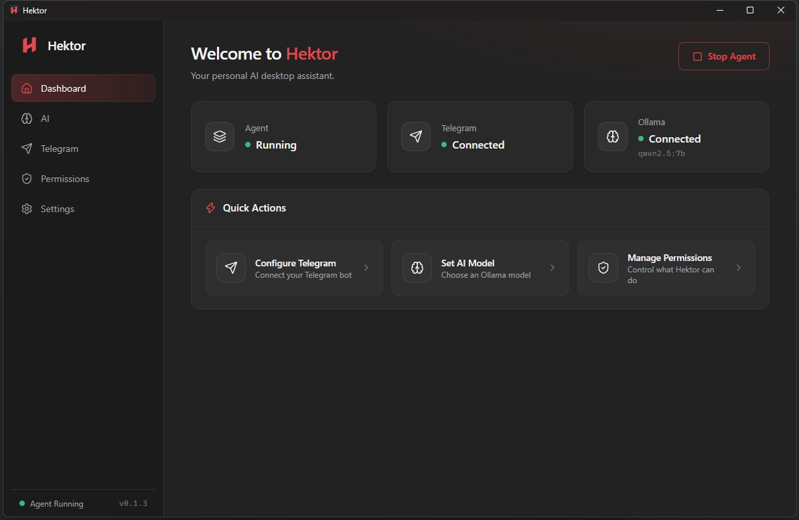
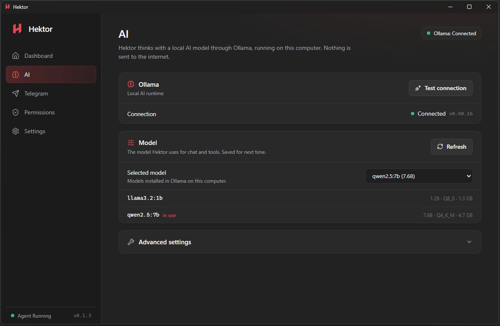
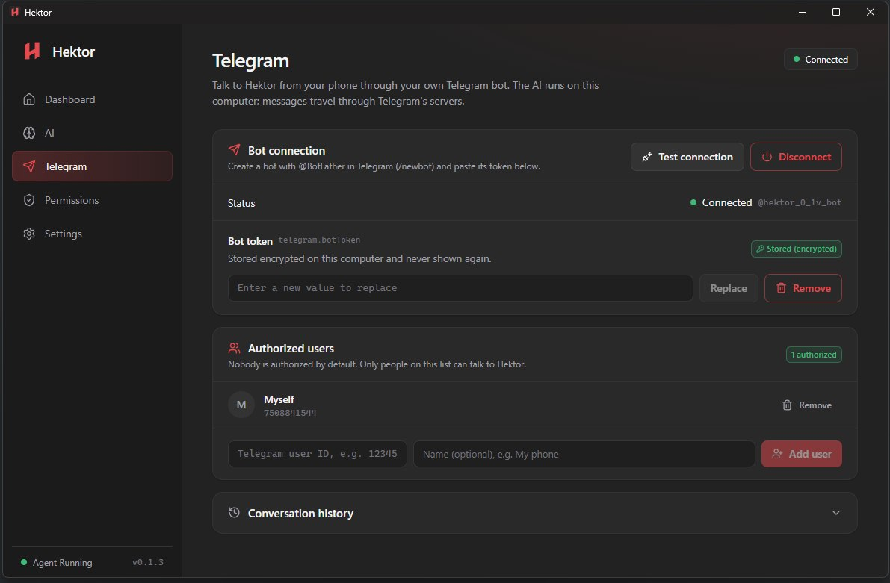
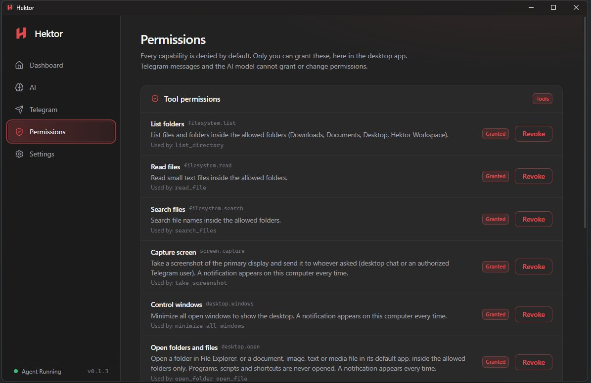
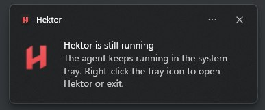

<h1>
  Hektor
  
</h1>

**Your personal AI assistant for Windows, powered by local AI and Telegram.**

Hektor is a Windows desktop assistant that uses local AI models through Ollama. You can chat with it directly from your computer or remotely through a Telegram bot.

The goal of Hektor is simple: provide a personal AI assistant that runs on your own computer, without depending on paid AI APIs.

### [Download Hektor for Windows](https://github.com/petrikgit/Hektor-AI-Assistant/releases/latest)

> **Version 0.1.3 — Early Release**
>
> Hektor is still in an early stage of development. It includes basic AI and Telegram functionality, but it is not a fully featured AI assistant yet.

---

## Which Folders Can Hektor Access?

Hektor currently has access to only four folders:

- **Downloads**
- **Documents**
- **Desktop**
- **Hektor Workspace** (`C:\Users\<you>\Hektor Workspace`, created on first start)

Everything else is blocked, including `C:\Windows`, Program Files, other drives, application data and Hektor's own database.

Hektor also blocks attempts to access files outside these folders using path tricks such as `..\` or shortcuts pointing to other locations.

If you want Hektor to access a file, simply copy it into one of the four allowed folders.

---

## What Can Hektor Do?

You can interact with Hektor through Telegram using natural language.

| You say on Telegram... | What happens | Permission needed |
|---|---|---|
| "What time is it?" | Gives the current date and time | None |
| "List my Downloads" | Lists files in a folder (up to 200) | List folders |
| "Read notes.txt on my Desktop" | Reads a text file (max 256 KB) | Read files |
| "Find PDF files in Documents" | Searches file names (up to 100 results) | Search files |
| "Send me a screenshot" | Sends a screenshot of your main screen | Capture screen |
| "Minimize everything" | Shows the desktop, like Windows + D | Control windows |
| "Open my Documents folder" / "Open photo.jpg" | Opens a folder or supported file on your PC | Open folders and files |

You can also combine requests, for example:

"Minimize everything and send me a screenshot."

---

## What Hektor Cannot Do

- **Create, edit or delete files.** File access is read-only.
- **Run programs, scripts or commands.** Hektor will not execute `.exe` or `.bat` files or shortcuts.
- **Process images, voice messages or file uploads through Telegram.** Only text messages are supported.
- **Respond to group chats.** Only private Telegram conversations are supported.

---

## Safety and Permissions

Hektor is designed to give users control over what the assistant can access and do.

1. **Everything is disabled by default.** Open the **Permissions** page and click **Grant** for each capability you want to enable. Only you can grant permissions through the desktop application. Neither the AI nor a Telegram message can grant permissions.
2. **Telegram users must be authorized.** Send a message to your bot to receive your numeric Telegram ID. Then add that ID under **Telegram → Authorized Users**.
3. **Windows notifications:** You receive a Windows notification whenever Hektor captures a screenshot, minimizes windows or opens something.
4. **Screenshots are not saved to disk.** They are sent directly to you and are not provided to the AI model.

> **Privacy note:** AI processing happens locally through Ollama, but Telegram messages, screenshots and file contents included in replies travel through Telegram's servers. Only grant the **Capture Screen** permission if you are comfortable with this.

---

## Telegram Commands

| Command | Description |
|---|---|
| `/help` | Shows available commands |
| `/reset` | Resets the current conversation context |

---

## Screenshots

### Dashboard

The main screen gives you an overview of Hektor, Ollama and Telegram connection status.



### AI Assistant

Connect to your local Ollama installation, select an installed model and chat directly with Hektor.



### Telegram

Connect your Telegram bot and interact with Hektor remotely from your phone or another device.



### Permissions

Manage the permissions available to Hektor.



### System Tray

Hektor can run in the background. Closing the window hides the application in the system tray instead of shutting it down.



---

## System Requirements

Hektor uses local AI, which means your computer does the work of generating responses. Performance depends heavily on your hardware and the selected AI model.

| Component | Minimum | Recommended |
|---|---|---|
| Operating System | Windows 10 (64-bit) | Windows 11 (64-bit) |
| RAM | 8 GB | 16 GB |
| Processor | 4-core CPU | Modern 6-core CPU |
| Storage | 10 GB free space | SSD with 15+ GB free space |
| GPU | Not required | Compatible GPU recommended |

These are general recommendations for the default Qwen 2.5 7B model. Requirements and performance may vary depending on the selected model.

### Does Hektor Work on Older Computers?

Yes, but performance may be slower.

Hektor was tested on a laptop with **8 GB of RAM**. The application and AI model worked, but responses took longer because Ollama uses a significant amount of system memory.

For a smoother experience, **16 GB of RAM is recommended**.

A dedicated GPU can improve performance, depending on its compatibility and available memory. A powerful GPU is not required, but CPU-only generation can be slower.

> Keep in mind that the AI model also takes up disk space and RAM. The recommended Qwen 2.5 7B model is not lightweight.

---

## Installation

### 1. Download Hektor

Download the latest Windows installer from the [GitHub Releases](https://github.com/petrikgit/Hektor-AI-Assistant/releases) page.

Run the installer and follow the instructions.

### 2. Install Ollama

Hektor uses Ollama to run AI models locally.

1. Visit [ollama.com](https://ollama.com/).
2. Download and install Ollama for Windows.
3. Make sure Ollama is running.

### 3. Download the AI Model

Open Command Prompt or PowerShell and run:

```bash
ollama pull qwen2.5:7b
```

This downloads the Qwen 2.5 7B model.

The download may take some time depending on your internet connection.

### 4. Connect Hektor to Ollama

1. Open Hektor.
2. Navigate to the **AI** section.
3. Check the Ollama connection.
4. Select the downloaded model.
5. Start chatting.

The default local Ollama address is:

```text
http://127.0.0.1:11434
```

### 5. Connect Telegram

Telegram is an essential part of Hektor. It allows you to interact with your personal AI assistant remotely from your phone or another device.

1. Open Telegram and search for [@BotFather](https://t.me/BotFather).
2. Send `/newbot`.
3. Follow the instructions to create a bot.
4. Copy the bot token.
5. Open Hektor and navigate to the **Telegram** section.
6. Enter your bot token and test the connection.
7. Connect your bot.
8. Send your bot a message.
9. Authorize your Telegram user ID in Hektor.

Only authorized users can interact with your assistant.

Once connected, you can send messages to Hektor directly from Telegram.

---

## Try Different AI Models

The default model used during development and testing is **Qwen 2.5 7B**.

However, this does not mean it is the best model for every computer or language.

Ollama supports many different models, and some of them may work better depending on your hardware, available RAM, GPU, language and personal preferences.

Feel free to experiment with other Ollama models. You might find a model that:

- Responds faster on your computer.
- Uses less RAM.
- Produces better answers in your preferred language.
- Works better with your hardware.
- Provides better results for your everyday tasks.

You can explore available models at [ollama.com/library](https://ollama.com/library).

If you find a model that works particularly well with Hektor, I'd love to hear about it. Feel free to contact me and share your experience or recommendations.

Community feedback can help improve future versions of Hektor.

---

## Project Vision

Hektor is built around one main idea: **your personal AI assistant should belong to you.**

I want Hektor to remain as free, private and independent as possible.

The long-term goal is to make Hektor work primarily on your own computer, using local AI models instead of relying on external AI services.

This means:

- Your computer runs the AI model.
- Your computer acts as the server for your personal assistant.
- Your conversations with the local AI stay on your computer.
- No paid AI subscription is required for the local AI functionality.
- No unnecessary cloud infrastructure or external AI services are required for local operation.

In future versions, I would also like to experiment with other AI providers and models, including:

- OpenAI
- Google Gemini
- Other open-source and local LLM providers

However, these integrations are planned experiments, not features currently available in version 0.1.3.

My priority is to keep Hektor as affordable and privacy-focused as possible. External AI providers may offer better performance or capabilities, but they can introduce additional costs and require sending data to third-party services.

**The ideal Hektor is an assistant that runs on your machine, uses your resources and keeps you in control of your data.**

---

## Privacy

Hektor is designed to keep AI processing as local and private as possible.

The main idea is simple: your computer runs the AI model and acts as the server for your personal assistant.

For more information about local processing, Telegram communication and data storage, see [PRIVACY.md](PRIVACY.md).

---

## Feedback and Contact

Hektor is an independent project and is still under development.

If you try Hektor, experiment with different AI models, discover bugs or have ideas for improvements, feel free to get in touch.

I'm especially interested in:

- Ollama models that perform well with Hektor.
- Models that work better on computers with limited RAM.
- Models with better support for different languages.
- Suggestions for new features.
- Bug reports and general feedback.

**Your feedback is welcome and can help shape the future of Hektor.**

Website: [danieldev.rs](https://danieldev.rs)

---

**Hektor 0.1.3 — A personal AI assistant running on your own computer.**
